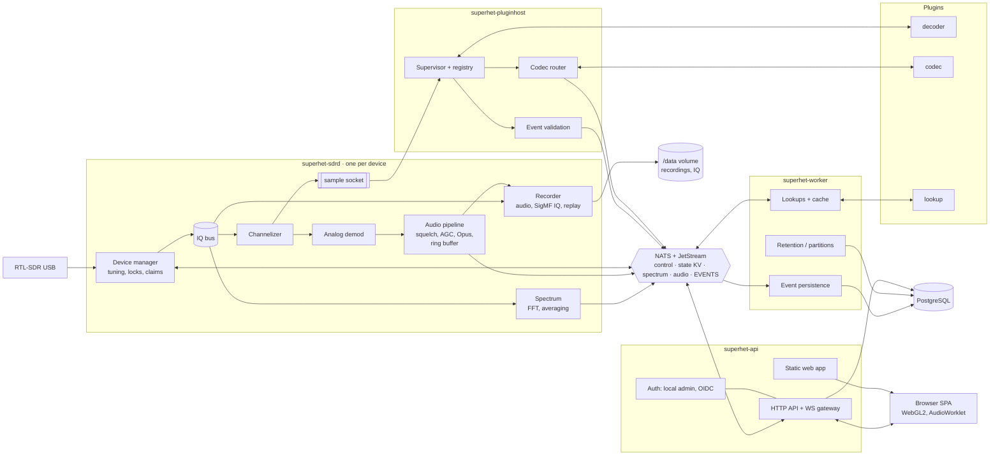
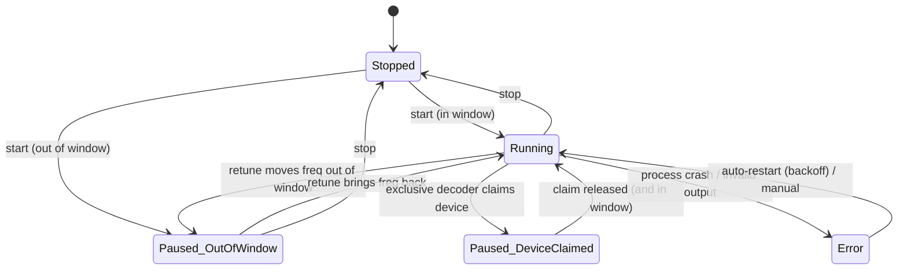

# Architecture

Status: draft (phase 0). Decisions referenced here are recorded in [adr/](adr/).

## 1. Overview

Superhet is a set of services (ADR-0007) plus plugin processes/containers and a single-page web frontend.



Concurrency inside sdrd: tokio for I/O; DSP runs on dedicated OS threads (device read, FFT, channel groups) connected by bounded lock-free queues, so async scheduling never stalls sample processing. Every stage counts dropped blocks (exported as metrics). A crash or restart of api, worker or pluginhost does not interrupt reception.

### Bus subjects (draft, defined in `superhet-bus`)

| Subject | Kind | Producer → consumer |
|---|---|---|
| `sh.v1.dev.<dev>.ctl.<cmd>` | request/reply | api/pluginhost → sdrd (tune, state, vfo.create/update/delete, lock.acquire/release, profile.load, tap.open/close, claim.acquire/release implemented; see `docs/api-devices.md`, `docs/plugin-contract.md`) |
| `sh.v1.dev.<dev>.tap.<id>` | pub/sub (core NATS, lossy) | sdrd → pluginhost (raw sample bytes in the format a plugin instance asked for with `ctl.tap.open`; leases, see `docs/plugin-contract.md` "Feeding input") |
| `sh.v1.dev.<dev>.state` | pub/sub + KV bucket `STATE` (key `dev.<dev>`) | sdrd → all (tuning, VFOs and lock holders implemented, one document per change; decoder bindings planned). The KV key `restore.<dev>` keeps the last state across restarts. Browsers receive the documents through `/api/v1/ws/state` (`docs/protocol-ws.md`) |
| `sh.v1.dev.<dev>.spectrum` | pub/sub | sdrd → api (quantised FFT frames, full band) |
| `sh.v1.dev.<dev>.spectrum.zoom` | pub/sub | sdrd → api (frames of the leased zoom slice, same format; ADR-0009) |
| `sh.v1.dev.<dev>.ctl.spectrum.zoom` | publish | api → sdrd (lease a zoom slice or release it; repeated every 3 s) |
| `sh.v1.dev.<dev>.audio.<stream>` | pub/sub (core NATS, lossy) | sdrd / pluginhost → api, recorder (binary `AudioFrame` v1 with one Opus packet each, mono or stereo, see `docs/protocol-audio.md`; `<stream>` is the VFO id for device VFOs) |
| `sh.v1.dev.<dev>.rds.<vfo>` | pub/sub (core NATS, lossy) | sdrd → api (JSON RDS state of a WFM VFO, repeated every second; api forwards it as a text frame on the audio WebSocket; `docs/protocol-audio.md`) |
| `sh.v1.events.<plugin>.<type...>` | JetStream `EVENTS` (7 days) plus core delivery | pluginhost → worker (durable consumer, persists into `decoder_events`), api (live); `<plugin>` = plugin id with `.` as `_`, one token per type segment (ADR-0014) |
| `sh.v1.lookup.<key>` | request/reply | api/worker → worker lookup service |
| `sh.v1.audit.<source>` | core NATS | sdrd/pluginhost → worker (persist as `audit_events`, `docs/api-audit.md`) |
| `sh.v1.plugin.ctl.<cmd>` | request/reply | api → pluginhost (`list`, `install`, `remove`, `instances`, `get`, `start`, `stop`, `restart`; `docs/plugin-contract.md`, REST in `docs/api-plugins.md`) |
| `sh.v1.plugin.state` | pub/sub (core NATS) | pluginhost → api (JSON `InstanceInfo` on every instance state change) |

## 2. Data flow: stick → browser

1. **Device read thread** pulls USB bulk transfers (librtlsdr async API), stamps each block with a sequence number, a monotonic timestamp and the tuning state (`center_hz`, `sample_rate`, `tuning_epoch`), converts `cu8` → `cf32` and publishes it on the IQ bus.
2. **IQ bus**: fixed-size ring of `Arc` sample blocks. Consumers read at their own pace; a consumer that falls behind loses blocks and increments its overrun counter instead of blocking the device thread.
3. **Spectrum service**: windowed FFT (Blackman-Harris, size 2048–16384 configurable), linear averaging / peak-hold, then per client: crop to the requested span, max-decimate to the client's bin count, quantise to `u8` dB with min/max in the header. ~1024–4096 bins × 25 fps ≈ 25–100 KB/s per client.
3a. Spectrum frames are published on NATS; **api** crops/decimates per browser client (requested span and bin count). Zoomed views get real resolution from a zoom FFT in sdrd (shift to the view centre, decimate, FFT; ADR-0009): api leases the slice the user looks at and serves the client from `spectrum.zoom` frames while they cover its view.
4. **Channelizer**: per channel (VFO or plugin input) a numerically controlled oscillator shifts the channel to baseband, then a multi-stage polyphase FIR decimates to the channel rate. If more than ~8 channels are active, switch to an FFT overlap-save filterbank (decision deferred to measurement in P1/P2).
5. **Demodulators** (VFOs) produce 48 kHz mono/stereo `f32` audio → squelch → AGC → **audio pipeline**: Opus encoder (20 ms frames) → WebSocket clients, recorder and always-on audio ring buffer.
6. **pluginhost** asks sdrd for per-instance taps (`ctl.tap.open`, ADR-0015; implemented as bus subjects `sh.v1.dev.<dev>.tap.<id>`, not as a socket) and feeds channelised data (IQ, the VFO's demodulated audio, or the whole window for exclusive claims, per manifest) into plugin processes and reads events/audio/voice frames back (§6).
7. **Events** go to JetStream `EVENTS`; worker enriches them via lookups and persists them (PostgreSQL); api pushes them live to subscribed browser clients.
8. **Browser**: one WebSocket per tab to **api** (the only exposed service); binary frames for spectrum/audio, JSON text frames for control and events. Waterfall rendered by WebGL2 (texture ring buffer, palette as 1D texture), audio decoded by WebCodecs `AudioDecoder` (Opus) with a WASM Opus fallback and played via an AudioWorklet jitter buffer.

### WebSocket framing (draft)

The spectrum socket is specified in `docs/protocol-ws.md` (implemented: `/api/v1/ws/spectrum`); it reuses the bus frame format instead of the envelope below.

Binary frame: `u8 kind | u8 flags | u16 stream_id | u32 seq | u64 timestamp_us | payload`.

| kind | payload |
|---|---|
| `0x01` spectrum | `f32 min_db, f32 max_db, u64 start_hz, u64 stop_hz, u8[] bins` |
| `0x02` audio | Opus packet (stream_id = VFO or call stream) |
| `0x03` iq-preview | reserved |

Text frames: JSON `{ "type": "...", ... }` for commands (`tune`, `vfo.update`, `profile.load`, …), state snapshots/diffs and events. Every text message carries a `v` (protocol version).

## 3. Tuning model

Definitions:
- **Window**: `[center − usable/2, center + usable/2]`, `usable = 0.85 × sample_rate` (anti-alias roll-off); published in the state document as `window`. A channel is inside if its whole bandwidth is. (A DC guard band is not enforced: the retune rule below keeps the active VFO off the centre.)
- **Binding**: every VFO and decoder instance has an absolute frequency (and bandwidth). Nothing stores offsets relative to the center.

### 3.1 Free tuning (default)

- The user drags/clicks anywhere in the spectrum or types a frequency. If the target channel is inside the window, only the VFO moves.
- If it is outside (the roll-off margin at the edge counts as outside), the **center follows**. The rule runs in `superhet-sdrd` when a VFO is created or its frequency, mode or bandwidth changes, so every client behaves the same (`crates/superhet-sdrd/src/window.rs`):
  - the target puts the active VFO at ¼ of the window width from the center, on the side it came from (off DC, room to continue in the same direction); a channel wider than half the window sits as far in as it fits, one wider than the window never retunes;
  - "fit" mode: the other VFOs that are inside the window now (later also *bound and running* decoders) are kept inside if they and the active VFO fit into the usable span together; the target center is then pulled just far enough. Otherwise the active VFO wins and the others pause;
  - with a tuning lock held (3.4) nothing retunes: the VFO stays where the user put it and is `paused` (the reply says `retune:"locked"`).
- Retunes caused by VFO moves are applied immediately (each moves the window by most of its width, so a drag causes few). Explicit `ctl.tune` requests are coalesced (~30 ms debounce, 150 ms at most). Each retune increments `tuning_epoch`; samples from the settling period are discarded downstream.

### 3.2 Profiles

A profile is a preset: `center_hz`, `sample_rate`, `gain` (mode + value), `ppm`, `bias_tee`, VFO list (freq, mode, bandwidth, squelch, …), a `lock` flag, later decoder instances (plugin id, freq, config; the `decoders` array is reserved) and an `exclusive` flag. Loading (`ctl.profile.load`) applies it atomically: everything is validated first, so a refusal (lock, unrealisable VFO, unsupported setting) changes nothing; the VFO set is replaced. "Save as profile" snapshots the daemon's current state. Profiles are versioned JSON (`superhet.profiles`, `data` jsonb, unique name) and exportable; the exact contract is `docs/api-profiles.md`. Bookmarks (saved frequencies, `superhet.bookmarks`): `docs/api-bookmarks.md`.

### 3.3 Decoder binding & states



Paused decoders keep their process alive for a grace period (default 60 s) and are then stopped, to be restarted transparently when the frequency returns. The UI shows the state on the decoder card and as a marker in the spectrum ("out of window" markers sit at the window edge with the frequency label).

### 3.4 Tuning lock & exclusive claims

- **Lock holders**: the user (manual lock), running recordings, optional "lock while a call is active" per decoder. While any holder exists, center/sample-rate changes (`ctl.tune`, profile load) are rejected with `code:"locked"` and the holders listed; VFOs can still move inside the window. Holders are a list of `{kind, id, since_ms}` in the state document (`locks`); only `kind:"user"` is implemented, the rest plugs in without a format change. The user lock is persisted with the restore snapshot.
- **Restore**: sdrd saves every state document under KV key `restore.<dev>` and re-applies it on start (tuning, VFOs with ids, user lock) when device id and driver match, before it serves any request.
- **Exclusive decoders** (e.g. ADS-B) send a claim: the device manager snapshots the current state, applies the decoder's `center_hz`/`sample_rate`, takes a lock, pauses all other consumers that do not fit, and restores the snapshot when the claim is released. Only one exclusive claim at a time.

## 4. Device layer

`superhet-device` defines a `Device` trait (open/close, capabilities, set center/sample rate/gain/ppm/bias-T, start stream → sample block channel, native sample format). Implementations: `rtlsdr` (librtlsdr via FFI, P1); later `soapy` (SoapySDR, covers Airspy/HackRF/SDRplay/SoapyRemote), `rtl_tcp` client, and a `file` device (SigMF/raw replay; used for tests and CI from P1 on). Multi-device later means one `superhet-sdrd` instance per device (`sh.v1.dev.<dev>.…` subjects), possibly on another host connected via a NATS leaf node; nothing else ever holds a device handle. See ADR-0001, ADR-0007.

## 5. Persistence

PostgreSQL (ADR-0006) via `sqlx`, schema `superhet`, migrations embedded in `superhet-db` and applied by api on start (sqlx serialises concurrent runs with a PostgreSQL advisory lock, so any further service may do the same; api needs the auth tables before it can serve a single request). Main tables (draft): `settings`, `users`, `sessions`, `oidc_identities`, `profiles`, `bookmarks`, `frequency_lists`, `plugins`, `plugin_instances`, `events` (partitioned by month, JSONB payload, generated `tsvector` + GIN, `pg_trgm` on identifiers), `lookup_cache`, `recordings`, `tetra_cells`, `tetra_subscribers` (self-learned from own network), `aircraft`, `vessels`.

DB roles: `superhet_api` (read most, write settings/profiles/bookmarks/sessions), `superhet_worker` (write events, lookups, partitions), `superhet_pluginhost` (plugin registry). Large binaries (recordings, IQ, ring buffer on disk) live on the `/data` volume, referenced by path; an S3-compatible storage backend is an option for later.

## 6. Plugin contract (protocol version 1)

The authoritative description is `docs/plugin-contract.md` (ADR-0014) with JSON Schemas in `crates/superhet-plugin-protocol/schema/`. The text below is the design background; where it differs (version 1 instead of 0, `[device]` claim keys `center_hz_min`/`center_hz_max`, `SUPERHET_*` environment, control subjects), the contract document wins.

### 6.1 Manifest `plugin.toml`

```toml
[plugin]
id = "org.superhet.decoder.pocsag"   # reverse-DNS, unique
name = "POCSAG / FLEX"
version = "0.1.0"                     # semver of the plugin
protocol = 1                          # host contract version
license = "GPL-2.0-only"              # SPDX
type = "decoder"                      # decoder | codec | lookup | ui
description = "POCSAG 512/1200/2400 and FLEX via multimon-ng"
homepage = "https://github.com/..."

[runtime]
kind = "process"                      # process | container
command = ["bin/adapter", "--mode", "pocsag"]
# image = "ghcr.io/owner/superhet-plugin-tetra:0.1.0"   # for kind = "container"

[input]                               # decoder only
kind = "discriminator"                # iq | discriminator | audio | voice_frames
sample_rate = 22050
format = "s16le"                      # cf32 | cs16 | cu8 | s16le | f32le
bandwidth_hz = 12500

[device]
exclusive = false                     # true: claims the device
# center_hz = 1090000000              # required if exclusive
# sample_rate = 2400000

[output]
events_schema = "schema/events.json"  # JSON Schema (draft 2020-12)
audio = false                         # or { sample_rate = 8000, channels = 1 }
voice_frames = []                     # e.g. ["ambe2+-3600x2450"], ["tetra-acelp"]

[ui]                                  # optional, see 6.6
widget = "ui/dist/widget.js"

[install]                             # optional
build = ["scripts/build.sh"]          # shown to the user before running
acknowledge = { text = "…license/patent notice…", url = "https://…" }
```

### 6.2 Transport modes

- **Simple mode** (default, fits wrapped CLI tools): `stdin` = raw sample stream in `input.format`, `stdout` = JSON Lines events, `stderr` = log lines (forwarded to the host log with plugin id).
- **Framed mode** (`[runtime] transport = "framed"`): one Unix domain socket per instance (path passed in `SUPERHET_SOCKET`), length-prefixed frames `u32 len | u8 kind | payload`: `hello` (JSON handshake: protocol version, instance config, capabilities), `samples` (header with seq, timestamp, tuning epoch), `control` (JSON: config change, flush), `event` (JSON), `audio` (PCM s16le), `voice_frame` (codec id, call id, timestamp, bytes), `log`, `heartbeat`. Required for audio, voice frames and runtime control.
- Containers get the socket via a shared volume; the host never exposes TCP to plugins.

### 6.3 Events

One JSON object per line:

```json
{"v":1,"type":"pocsag.message","ts":"2026-10-20T18:00:00.123Z","data":{"address":123456,"function":0,"text":"…"}}
```

The host validates against `events_schema` (invalid lines are counted and dropped), adds `plugin_id`, `instance_id`, `freq_hz`, a host timestamp, and persists/dispatches it. Well-known `type` prefixes get first-class UI (e.g. `call.start`/`call.end` with `call_id`, `src`, `dst`, `encrypted` for voice decoders).

### 6.4 Codec plugins

- A codec plugin declares `type = "codec"` and `[codec] frames = ["tetra-acelp"]`, `pcm = { sample_rate = 8000, channels = 1 }`, framed transport only.
- Decoders emit `voice_frame`s tagged with a codec id and `call_id`. The **codec router** forwards them to an installed codec plugin for that id; returned PCM is resampled to 48 kHz and becomes a *call audio stream* (same audio pipeline as VFOs: Opus, ring buffer, recording).
- No codec installed → frames are discarded, events and metadata continue unaffected; the UI shows "voice: codec not installed".
- Codec ids (initial): `tetra-acelp`, `ambe-3600x2400` (D-Star), `ambe2+-3600x2450` (DMR, YSF DN, NXDN, dPMR), `imbe-7200x4400` (P25 P1, YSF VW), `codec2-3200` (M17). See ADR-0005.

### 6.5 Lookup plugins

`type = "lookup"`, framed transport. Declares the keys it resolves (`dmr_id`, `callsign`, `icao24`, `mmsi`, …), its cache TTL and rate limit. The host owns caching (`lookup_cache`), rate limiting and the per-source on/off switch; plugins only perform the remote call. Built-in lookups use the same interface in-process.

### 6.6 UI plugins

ES module exporting `register(api)`; the host loads it dynamically. The API (versioned, documented in P5) gives: subscribe to events of the plugin's type, read tuning/VFO state, issue tune commands, register panels/widgets/command-palette entries. Single-user deployment → no hard sandbox; plugins are trusted code installed by the admin.

### 6.7 Lifecycle & supervision

Install via pluginhost (Git URL or local path → copy to `/data/plugins/<id>/<version>`, show manifest + build commands + license acknowledgement → build) → enable → instances started on demand (decoder bound to a frequency) → health via heartbeat/stdout activity → crash → restart with exponential backoff (max 5 in 5 min, then `Error`). Resource limits per instance via cgroups (container) or `prlimit` (process) where available.

## 7. Auth

- Auth lives in **api** only (ADR-0008, contract in `docs/api-auth.md`). First run: create the local admin (Argon2id hash), guarded by a one-time setup token that api logs at startup. Login → server-side session in PostgreSQL (`superhet.users`, `superhet.sessions`; only the SHA-256 of the cookie token is stored; 7 d idle / 30 d absolute), `HttpOnly; SameSite=Strict` cookie, `Secure` when served over https. Failed logins are rate limited per client address and globally.
- Everything except `/healthz`, `/readyz` and `/api/v1/auth/*` sits behind the session check (deny by default, including unknown paths).
- Planned (P1.5, ADR-0011/0012): roles `admin`/`operator`/`listener`, per-user sessions, invite links, VFO ownership, optional guest sessions (off by default), append-only `audit_events` and an admin console. This supersedes the single-user statements in this section and in ADR-0008 once implemented; the mechanics above (hashing, sessions, cookie, rate limits, deny by default) stay.
- OIDC (P5): Authorization Code + PKCE via the `openidconnect` crate, generic issuer discovery, tested against Zitadel; claim → local user mapping; local admin stays as fallback (can be disabled).
- WebSocket upgrade requires a valid session and an `Origin` check; state-changing HTTP routes check `Origin` too. All config changes go through authenticated endpoints. No anonymous listening mode (single user).

## 8. Deployment & security

- `compose.yaml`: `postgres`, `nats`, `superhet-sdrd` (USB passthrough), `superhet-pluginhost`, `superhet-worker`, `superhet-api` (only service with a published port, 8073); internal network; health-check based start order. Optional `compose.plugins.yaml` for container plugins (generated by plugin install, applied by the admin – no Docker socket is mounted anywhere).
- Secrets (DB and NATS passwords, session key) in `.env`, generated by `scripts/gen-secrets.sh`, never committed; `.env.example` documents them.
- NATS: one user per service with subject permissions; monitoring port not published.
- Containers run as non-root, read-only root filesystem where possible, `no-new-privileges`, dropped capabilities; only sdrd gets the USB device.
- TLS terminates at the user's reverse proxy (documented example for Caddy/Traefik); api sets secure cookies and CSP.
- Host prerequisites: blacklist `dvb_usb_rtl28xxu` (`deploy/modprobe/`), udev rule (`deploy/udev/`).
- Later: install script for Debian/Arch with systemd units per service (`deploy/systemd/`), PostgreSQL and NATS from distribution packages.

## 9. CPU budget (estimates, to be measured in P1)

Reference: dev PC (modern x86-64 desktop). Values are % of one core at 2.4 MS/s.

| Stage | Estimate |
|---|---|
| USB read + `cu8`→`cf32` | 1–3 % |
| FFT 4096 @ ~25 fps display, full-rate averaging | 1–3 % |
| Channelizer + NFM demod, per VFO | 2–5 % |
| WFM stereo + RDS, per VFO | 5–10 % |
| Opus encode, per stream | ~1 % |
| multimon-ng / direwolf (plugin) | 1–3 % |
| dsd-fme / digiham (plugin) | 5–10 % |
| readsb (exclusive) | 10–20 % |
| TETRA (GNU Radio demod + tetra-kit) | 10–25 % |

Targets: P1 core (waterfall + 4 NFM VFOs + 1 browser client) ≤ 25 % of one core on the dev PC; small VM (2 vCPU, 2 GB RAM) runs core + 2 decoders without sample drops (IQ ring buffer on disk, not RAM).
